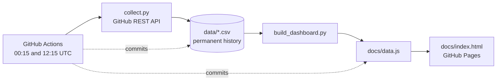

# GitHub Traffic Analytics

[](https://github.com/jadhavS04/github-traffic-analytics/actions/workflows/collect.yml)
[](https://jadhavs04.github.io/github-traffic-analytics/)

An automated pipeline that archives GitHub repository traffic permanently and presents it in an interactive dashboard.

GitHub keeps only the **last 14 days** of views and clones for each repository. This project collects that data on a schedule, merges it into a permanent history, and publishes the analysis as a static website, with no server or database to run.

**Live dashboard:** https://jadhavs04.github.io/github-traffic-analytics/

---

## Features

- **Permanent history.** Each run merges the 14-day window into CSV files, so the record grows without limit.
- **Idempotent daily merge.** A date collected again is overwritten with the latest value. A new date is appended. Re-running never creates duplicates.
- **Gap-aware.** Days with no traffic are stored as real zeros, so charts and averages are accurate.
- **Broad coverage.** Traffic, audience sources, popular pages, and repository health in one place.
- **Resilient collection.** A failure on one repository or endpoint is logged and skipped. The rest of the run still saves.
- **Zero infrastructure.** GitHub Actions collects, GitHub Pages serves, and the repository itself stores the data.
- **Configurable.** Track every public repository you own, or only the ones you list.

## What is collected

| Category | Metrics | Granularity |
|---|---|---|
| Traffic | Views, unique visitors, clones, unique cloners | Daily, kept permanently |
| Audience | Top referrers, popular pages | Daily snapshot of GitHub's rolling 14-day top 10 |
| Growth | Stars and forks, with the date of each | Full history |
| Health | Watchers, open issues, open pull requests, repository size | Daily snapshot |
| Distribution | Release asset download counts | Daily snapshot |
| Code | Languages (bytes), commits per day | Language snapshot, daily commit counts |

## Dashboard

The dashboard is a single static page that needs no build step.

- Views and clones with unique counts and an optional 7-day moving average
- KPI strip with change versus the previous period
- Cumulative stars and forks
- Average views by weekday, and a 26-week daily heatmap
- Automatic insights: busiest day, strongest weekday, traffic spikes, a 30-day projection, stars per 1,000 views, and clone-to-view ratio (a high ratio often points to bots or CI)
- Sortable repository comparison table
- Referrer and popular-page tables, plus a referrer trend chart
- Commit activity, language breakdown, and release downloads
- Date ranges of 7 days, 30 days, 90 days, 1 year, or all time, and CSV export

## How it works



1. The workflow runs twice a day. The 00:15 UTC run finalises the previous day, and the 12:15 UTC run refreshes the current day's partial numbers.
2. `collect.py` reads the traffic and repository endpoints and upserts rows into `data/*.csv`. A row's key is `(repo, date)`, so the newest value wins.
3. `build_dashboard.py` converts the CSVs into `docs/data.js`.
4. The workflow commits `data/` and `docs/`, and GitHub Pages publishes the updated site.

## Repository structure

```
.github/workflows/collect.yml   Scheduled workflow: collect, build, commit
scripts/collect.py              API collector and CSV merge logic
scripts/build_dashboard.py      Converts CSV history to docs/data.js
scripts/schema.py               Table definitions shared by both scripts
docs/index.html                 Dashboard (served by GitHub Pages)
data/                           CSV history, one file per metric
config.json                     Which repositories to track
requirements.txt                Python dependencies
```

### Data files

| File | Key | Contents |
|---|---|---|
| `views.csv` | repo, date | Daily views and unique visitors |
| `clones.csv` | repo, date | Daily clones and unique cloners |
| `referrers.csv` | repo, date, referrer | Top referrers per snapshot |
| `paths.csv` | repo, date, path | Popular pages per snapshot |
| `repo_stats.csv` | repo, date | Stars, forks, watchers, issues, PRs, size |
| `releases.csv` | repo, date, tag, asset | Cumulative download counts |
| `languages.csv` | repo, date, language | Bytes per language |
| `commits.csv` | repo, date | Commits per day |
| `stargazers.csv` | repo, user | When each star happened |
| `forks.csv` | repo, fork | When each fork was created |
| `runs.csv` | run_at | Log of collector runs |

## Setup

### Requirements

- A GitHub account with push access to the repositories you want to track (GitHub only returns traffic to users with push access)
- A personal access token (see below)

### 1. Create a token

The built-in Actions token cannot read traffic data, so a personal access token is required.

- **Classic token:** https://github.com/settings/tokens → *Generate new token (classic)* → select the **`repo`** scope.
- **Fine-grained token:** grant access to the repositories and set **Administration: Read**, **Contents: Read**, and **Metadata: Read**.

### 2. Add the secret

In the repository: **Settings → Secrets and variables → Actions → New repository secret**.

- Name: `GH_TOKEN`
- Value: the token

### 3. Allow the workflow to commit

**Settings → Actions → General → Workflow permissions → Read and write permissions → Save.**

### 4. Run the collector

**Actions → Collect GitHub traffic → Run workflow.** In the log, each tracked repository should show `ok`.

### 5. Publish the dashboard

**Settings → Pages → Build and deployment → Deploy from a branch → `main` and `/docs` → Save.**

The site is then available at `https://<username>.github.io/<repository>/`.

## Configuration

Edit `config.json` to control what is tracked.

```json
{
  "owner": "",
  "repos": ["jadhavS04"],
  "exclude": [],
  "include_forks": false,
  "include_archived": false,
  "include_private": false,
  "collect_stargazers": true,
  "collect_forks": true
}
```

| Key | Description |
|---|---|
| `owner` | GitHub user to collect for. Leave empty to use the token owner. |
| `repos` | Repository names to track. Leave empty to track every repository you own. |
| `exclude` | Repository names to skip when `repos` is empty. |
| `include_forks` | Include forked repositories. Default `false`. |
| `include_archived` | Include archived repositories. Default `false`. |
| `include_private` | Include private repositories. Default `false`. |
| `collect_stargazers` | Record star history. Default `true`. |
| `collect_forks` | Record fork history. Default `true`. |

> **Privacy note:** collected data is committed to this repository. If the repository is public, anyone can read it. Keep `include_private` set to `false` unless this repository is private as well.

## Running locally

```bash
git clone https://github.com/jadhavS04/github-traffic-analytics.git
cd github-traffic-analytics
pip install -r requirements.txt

export GH_TOKEN=your_token
python scripts/collect.py --check   # verify the token and permissions
python scripts/collect.py           # collect and merge into data/
python scripts/build_dashboard.py   # rebuild docs/data.js
```

Open `docs/index.html` in a browser to view the dashboard.

## Troubleshooting

| Symptom | Likely cause and fix |
|---|---|
| `GH_TOKEN is not set` | The secret is missing or misspelled. The name must be exactly `GH_TOKEN`. |
| `token rejected` | The token expired or was revoked. Create a new one and update the secret. |
| `HTTP 403` on `traffic/views` | The token lacks the `repo` scope (classic) or *Administration: Read* (fine-grained). |
| `HTTP 404` on traffic endpoints | The token owner has no push access to that repository. |
| Run succeeds but nothing is committed | Workflow permissions are not set to *Read and write*. |
| Dashboard shows "No traffic saved yet" | Run the workflow once and confirm Pages is set to `main` and `/docs`. |
| Dashboard shows old data | Hard refresh with Ctrl+Shift+R and confirm the "pages build and deployment" run finished. |
| Collection stopped after some weeks | GitHub can pause schedules on inactive repositories. Re-enable the workflow in the Actions tab. |

## Limitations

- **History begins on the first run.** GitHub cannot supply traffic older than 14 days.
- **Run at least every 14 days.** A longer gap permanently loses the missing days. The schedule runs twice daily, so this only matters if the workflow is disabled or the token expires.
- **Referrers and pages are rolling top-10 lists.** They are stored as one snapshot per day, not as exact daily counts.
- **Unique counts are per day.** Summing them across days counts a returning visitor more than once.
- **Today is partial.** The current day's numbers are final only after the next 00:15 UTC run.
- **Profile repositories** only record traffic to the repository page itself. Visits to the profile page that displays its README are not counted by GitHub.

## Tech stack

Python 3.12, GitHub REST API, GitHub Actions, GitHub Pages, Chart.js

## Author

**Shubham Jadhav** · [GitHub](https://github.com/jadhavS04)
